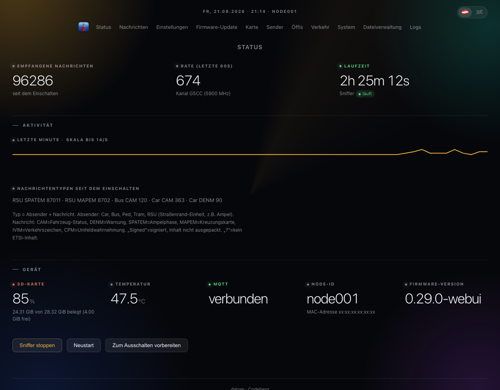
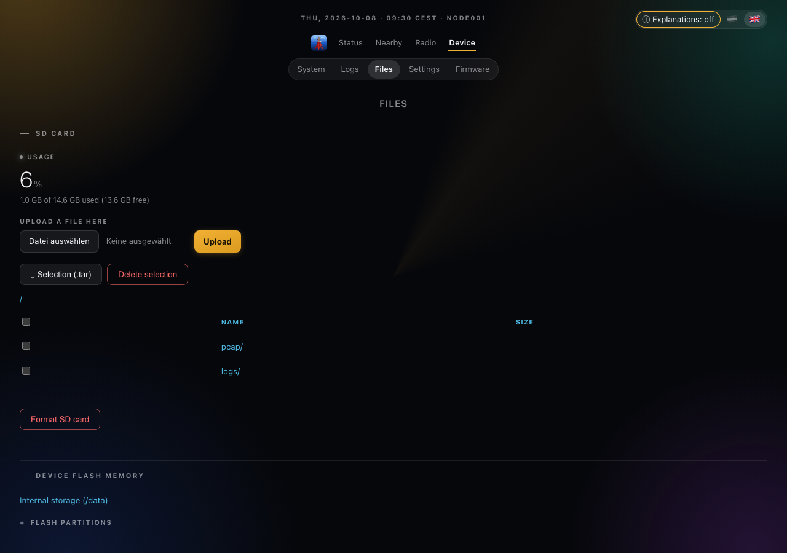

# ITS-G5 Receiver Firmware (Web-UI Fork)

Modified firmware for the **opentrafficmap ITS-G5 receiver** (official board,
HW variant `i5r-r1`) — a passive 802.11p / ITS-G5 (V2X) sniffer on ESP32-C5 that
forwards raw frames over MQTT. This fork adds a built-in web interface, a live
map, on-device PCAP recording with playback, and a number of bug fixes on top
of the upstream firmware.

Upstream base: https://codeberg.org/opentrafficmap/its-g5-receiver-firmware



*Status page. The node ID and MAC address are masked in this screenshot.*



*File management: flash partitions and the SD card.*

## Download

Pre-compiled binaries are available under
[**Releases**](https://codeberg.org/datom/its-g5-receiver-firmware-webinterface/releases)
— the newest release is at the top of that page. Download
`its-g5-receiver-firmware.bin` and flash it via the web interface (`/update`),
or grab all four `.bin` files for an initial flash over serial (see below).
No build environment needed. The version history below lists what changed in
each release.

> ⚠️ **Upgrading from 0.16.0 (or earlier) to 0.20.0 must be done once over
> USB/serial with all four `.bin` files** (see
> [Flashing a pre-compiled firmware](#flashing-a-pre-compiled-firmware)).
> 0.20.0 changes the **partition table** (it adds a coredump partition), and
> the web `/update` OTA only ever writes the app slot — it cannot apply a new
> partition table. After this one serial flash, routine updates can go back
> to the web interface as usual.

## Version history

Newest first. The app version comes from `version.txt` (scheme `<base>-webui`).

| Version       | Changes |
|---------------|---------|
| **0.25.1-webui** | Fix: compiling for the alternative SPI Ethernet chips (W5500, ENC28J60) works now, and the prototype sdkconfigs are updated to match. The network-LED switch stays KSZ8851SNL-only — the W5500 has no LED register, the ENC28J60 would allow it but is untested for lack of hardware — and such builds hide the setting in the web interface. |
| **0.25.0-webui** | The Ethernet port's two LEDs can be switched off from the settings page, taking effect immediately. Also adds a "prepare for power-off" button that flushes every buffer and unmounts the SD card, and the same flush now runs before each deliberate restart, so a reboot no longer discards the buffered recording. |
| **0.23.0-webui** | The map can show the vehicle tracks of every configured receiver at once, each in its own colour, as a second switchable layer. |
| **0.22.7-webui** | Fixes 28 defects, among them a script injection from a MAPEM intersection name, a deadlock on an MQTT `sniffer --stop`, an SD unmount racing an in-flight write, and four decoder faults. Each device now advertises a unique mDNS instance name and browser-tab title. |
| **0.22.4-webui** | All decoders (CAM, DENM, SPATEM, MAPEM) validated against the ETSI standards, fixing the DENM cause code and CAM size limits. Adds vehicle detail in map popups (heading, braking, lights, role), a switchable vehicle-track layer, multi-receiver map sharing, and recording thinning. |
| **0.20.2-webui** | The SD system log now writes a dated header line (`===== YYYY-MM-DD (Day) =====`) at each session start and midnight rollover, so a multi-day log can be pinned to a calendar day. |
| **0.20.1-webui** | The status and system pages update live via a small JSON poll instead of reloading the whole page — the animated background no longer restarts each refresh, and `/system`'s uptime, RAM and task table now actually update while open. |
| **0.20.0-webui** | Large feature release. Adds rolling PCAP capture to SD with map playback (scrub through recorded traffic on `/map`), RSU/traffic-light positions and vehicle speed on the map, and crash-dump-to-flash for offline debugging. Also a new visual theme and a stability round (MQTT fix, hashed web password, tuned SD-card timing, a newer ESP-IDF pin — see Building). Changes the partition table — see the upgrade note above. |
| **0.16.0-webui** | New **live map** (`/map`): decodes each CAM's position and shows nearby vehicles/RSUs on an OpenStreetMap map, as clickable emoji markers per station type (details on click: type, time, RSSI, length), with a satellite-view layer toggle. Verified byte-exact against real captured traffic. |
| **0.15.1-webui** | Three code-audit fixes: an mDNS startup race with static IPs, an unsynchronized activity-stats read, and SD-download filename sanitization. |
| **0.15.0-webui** | New **system monitor** for unattended field operation: watchdog auto-recovery if the sniffer pipeline wedges, SD auto-remount, a low-heap guard, and **mDNS** (`its-<nodeid>.local`). Clearer reset-reason labels on `/system`. A round of web-UI polish: rounded table corners everywhere, consistent heading styles, a flag-based language switch, mobile layout fixes (settings table no longer overflows, hex/type columns wrap), localized `/update` error messages, and several smaller fixes (temperature log spam, upload button spacing, IP field length limits). |
| **0.14.1-webui** | The "Type" column now names the actual message type (CAM, DENM, **SPATEM**, **MAPEM**, IVIM, CPM, ...) read from the ITS PDU `messageId`, instead of a raw `GeoNet:<port>` — so a traffic light now reads e.g. "RSU SPATEM" / "RSU MAPEM" rather than "RSU GeoNet:2004". A short hint explaining the column (sender type + message type, and what "Signed"/"?" mean) is shown on both `/messages` and the status page. Verified against real captured traffic. |
| **0.14.0-webui** | The "Type" column on `/messages` now also shows the sender's station type (Car, Bus, Pedestrian, RSU/traffic-light unit, ...), e.g. "Bus CAM" or "RSU GeoNet:2004" — including for signed/secured messages, which is most real road traffic. A short hint under the status page's activity breakdown explains what "Signed" and "?" mean. |
| **0.13.0-webui** | **Live message feed:** `/messages` now updates over a WebSocket (`/ws`) roughly once a second instead of a periodic full-page reload — no more flicker or lost scroll position. Falls back gracefully (reconnects with backoff) if the WebSocket is unavailable. **C-ITS message-type labelling:** each received frame is now walked through its LLC/SNAP → GeoNetworking → BTP-B headers to identify the facility message type, shown in a new "Type" column. Only **CAM** and **DENM** (ETSI TS 103 301 BTP ports 2001/2002) are labelled by name with confidence; other recognised ports show as `GeoNet:<port>` rather than a guessed name, and frames secured per ETSI TS 103 097 (common on real road traffic) show as `Signed` (the certificate/signature envelope isn't decoded). **Activity stats** on the status page: a 60-second packets/sec sparkline and a message-type breakdown, built from counters that already existed. **Configurable NTP server** on the settings page (was hard-coded to `pool.ntp.org`). |
| **0.12.0-webui** | **Ethernet / network settings** on the settings page: a DHCP toggle (on = automatic IP), and — with DHCP off — static **IP address**, **subnet mask** and **gateway**, plus up to three manual **DNS servers**. DNS applies in both modes (a configured manual DNS overrides the DHCP-provided one after the lease is obtained). The static-IP/DNS backend already existed; this exposes it in the browser. Network changes take effect after a reboot; inputs are validated as IPv4 and the static trio is stored atomically. Also: the browser-tab favicon now carries a `?v=` cache-buster so the Tokyo-tower icon reliably replaces the old satellite favicon that browsers had cached. The settings page also shows the network status **currently in effect** (the live IP/netmask/gateway/DNS actually bound — e.g. the address obtained over DHCP) above the editable fields, read from the netif at request time rather than from the stored config. |
| **0.11.1-webui** | Each partition on the file-management page can be downloaded as a **raw image** (`.img`, via `esp_partition_read`) — the non-filesystem partitions (`nvs`, `phy_init`, `otadata`, `ota_0/1`) are raw regions without files, so a raw dump is the only way to read them; a note on the page explains this. **Bulk download** in the SD-card and internal (`/fs`) browsers: per-row checkboxes plus a header "select all / deselect all" checkbox let you pick multiple files/folders and download them together as one streamed `.tar` via the "Selection (.tar)" button (folders added recursively; to grab a whole directory just select-all). No compression lib needed; folder recursion is bounded by the FAT open-handle limit. The status page's sniffer button now reads "Sniffer stoppen" / "Stop sniffer" (correct word order per language) instead of "Stoppen Sniffer". |
| **0.11.0-webui** | The "SD card" page is now **File management**: it shows the flash partition table at the top (label, type, size, the running app slot marked *active*, and the internal FAT partition's usage) so you can see what is stored where, followed by the SD-card browser as before. The internal FAT partition (`storage`, mounted at `/data`) is clickable and opens a read-only browser (`/fs`) so you can view and download its contents (no upload/delete/format — it's system storage). Unified page width: all subpages now share the same content column (max 1040 px, centred) and key-value boxes are full-width — previously status/settings/system looked narrower and left-aligned, like a different design. |
| **0.10.1-webui** | Responsive fixes: the layout now scales to the display (up to 1600 px on desktop), inputs no longer overflow on mobile, key-value tables stay readable, and wide data tables (`/messages`, task list, SD listing) scroll horizontally instead of cramping. Memory details now live only on `/system` (the status page dropped its RAM rows — the two pages showed slightly different *free* values because it's a live counter read at different moments; min/total always matched). App icon no longer contains the "ITS G5" wordmark — just the tower. |
| **0.10.0-webui** | Web-UI restyle: modern dark theme with a rounded nav bar (current page highlighted), content in cards, status/MQTT shown as coloured badges, metric tiles on the status page, and accent-blue buttons/inputs — responsive up to 1100 px so desktop uses the width. Home-screen icon fixes (icon fills the tile, `sizes` attribute + 180×180 manifest entry for iOS). PSRAM offloading to relieve the scarce internal SRAM: TLS buffers via `MBEDTLS_EXTERNAL_MEM_ALLOC`, allocations >4 KB prefer PSRAM (`SPIRAM_MALLOC_ALWAYSINTERNAL=4096`), and the web server's static scratch buffers moved to PSRAM `.bss`. Status page now shows RAM as free/min/total like `/system` (the two pages always read the same counter — differences were just snapshot timing). Suppressed the harmless `httpd recv error 104` (ECONNRESET) log spam from browsers aborting keep-alive connections. |
| **0.9.0-webui** | New app icon (glossy "Aero"-style Tokyo-tower with incoming-signal arrows and "ITS G5"), full-bleed so iOS shows no white border. Installable as a home-screen web app: PWA `manifest.webmanifest` + Apple web-app meta tags, favicon/apple-touch-icon and 192/512 icons embedded via `EMBED_FILES`. First release following strict SemVer 2.0.0 (features bump MINOR: 0.9 → 0.10 → 0.11 …, fixes bump PATCH). |
| **0.8.4.1-webui** | Real PNG apple-touch-icon (satellite) so iOS shows an icon when saving the page to the home screen; icon paths are now wildcard-matched so the sized variants iOS probes no longer 404 in the log. Browser tab title is now always "ITS G5 Node". Removed the wrong hard-coded "auto-refreshes every 5 s" status-page line (the interval is configurable and shown on the pause button), and moved that button to the bottom-right so it no longer overlaps the language switch. |
| **0.8.4-webui** | Fix a reboot when opening the `/sdcard` page: the directory-listing handler used ~14 KB of large scratch buffers on the single httpd task's stack, overflowing it. Those buffers are now `static` (off-stack; safe because the HTTP server handles requests sequentially in one task). |
| **0.8.3-webui** | Satellite favicon (inline SVG) that also silences the browser icon 404s in the log; real wall-clock timestamps in the logs (system log via `LOG_TIMESTAMP_SOURCE_SYSTEM`, frame CSV as `YYYY-MM-DD HH:MM:SS`); configurable web-UI auto-refresh interval (settings, 0 = off) plus a floating ⏸/▶ pause button that persists per browser. |
| **0.8.2-webui** | New `/logs` page: view the SD log files (`system.log`, `frames.csv`) directly in the browser (tail of the last 24 KB), with a switcher and refresh. Password-protected, content HTML-escaped. |
| **0.8.1-webui** | New `/system` page: chip/CPU info, ESP-IDF version, last reset reason, uptime, internal + PSRAM memory (free/min/total), and a task table with live per-task CPU load (delta-measured), state, priority and min free stack. Enables FreeRTOS run-time stats. |
| **0.8.0-webui** | SD logging: optional rotating system log (`/sdcard/logs/system.log`) and received-frame CSV log (`frames.csv`) with a configurable size budget, all toggled on the settings page. Buffered via a PSRAM ring + dedicated writer task so the sniffer hot path stays free. |
| **0.7.1-webui** | Security hardening for the SD card manager: `/sdcard` (browsing) and `/sdcard/download` now require the web password like the other write actions do; fixed a reflected-XSS in the path breadcrumb (`?p=` was rendered unescaped); rejected control characters (CR/LF) in paths/filenames to prevent HTTP response header injection via `Content-Disposition`. |
| **0.7.0-webui** | SD card manager in the web interface: new `/sdcard` page to browse folders/files, see storage usage, upload files, delete files, and format the card. The card is auto-mounted at boot. Write actions honour the web password. |
| **0.6.5-webui** | Status page now reports internal SRAM and PSRAM free heap separately. Previously "free heap" summed all regions, so the 8 MB PSRAM hid the scarce internal RAM (it always read ~8 MiB). |
| **0.6.4-webui** | Fix garbled German umlauts in JS dialogs / plain-text responses: the "uploading", "reboot the device?" and "confirmed" messages showed `&auml;` literally because they are set via `innerText`/`confirm()`/`alert()`, which don't decode HTML entities. |
| **0.6.3-webui** | Web password field on `/settings`: set or remove the `webpasswd` protection directly from the browser (previously console only). |
| **0.6.2-webui** | NTP time sync. `/messages` now shows the real local wall-clock time (`HH:MM:SS`, Europe/Berlin) once synced, instead of a device-relative `seconds.ms` value. |
| **0.6.1-webui** | "Confirm update" button on the status page, so a web/OTA update can be confirmed (rollback cancelled) from the browser. |
| **0.6.0-webui** | First web-UI firmware: status dashboard, `/messages`, `/settings`, browser `/update` (OTA), optional password protection. Round-1 bug fixes: sniffer format-string bugs, OTA reentrancy guard, swapped config case labels. |

## Web interface

Once the device has an IP address, a built-in web interface is available on
port 80. German by default; append `?lang=en` (or use the language link) for
English.

- `/` — status dashboard: node ID, MAC, firmware version, sniffer state, active
  channel, MQTT status, uptime, packets received, packet rate (last 60 s), free
  heap, temperature. Auto-refreshes (interval configurable on `/settings`);
  Start/Stop sniffer and Reboot buttons. If the running firmware was installed
  via update and not yet confirmed, a banner with a **Confirm update** button
  appears here.
- `/messages` — the last 20 received frames (time, RSSI, length, type, hex
  preview), newest first, live over WebSocket. Times are real local `HH:MM:SS`
  once NTP has synced (see 0.6.2).
- `/map` — live map of decoded positions: vehicles (from CAM) and stationary
  senders such as traffic lights / RSUs (from the GeoNetworking layer), one
  emoji marker per station type, clickable for details (and km/h for
  vehicles). A **from/to time range + Load** control below the map replays
  positions recorded in the PCAP files (see `/settings`) with a slider and a
  play button; a **Live** button returns to the real-time feed. Map tiles
  need the browser to have internet access (OpenStreetMap) — the device
  itself does not.
- `/settings` — view and change node ID, MQTT URI, autostart channel, LED
  brightness (applied live), the web password, network (DHCP / static IP /
  DNS), NTP server, SD logging, and **rolling PCAP capture** (off by default:
  raw frames to `/sdcard/pcap/`, with retention hours + a storage ceiling).
  Saved to NVS.
- `/update` — upload a `.bin` from the browser to flash the inactive OTA
  partition; the device reboots into it.
- `/system` — chip/CPU info, ESP-IDF version, last reset reason, uptime,
  internal + PSRAM memory, and a per-task CPU-load table. Shows a banner with
  a download/delete link if a crash dump is available.
- `/sdcard` — browse the SD card, see usage, upload/delete files (single or
  multi-select), download files/folders as a `.tar`, format the card
  (requires the web password). Recorded PCAP files live under `/sdcard/pcap/`
  and can be downloaded here and opened in Wireshark/tshark.
- `/logs` — view the SD log files (`system.log`, `frames.csv`) inline in the
  browser. Logging is toggled on `/settings`.

A configurable auto-refresh (interval on `/settings`, `0` = off) with a floating
pause/resume button keeps the status page live; `/messages` and `/map` update
over a WebSocket without reloading.

### Update confirmation (rollback)

After a web/OTA update the new firmware must be confirmed within **30 minutes**,
otherwise the device automatically rolls back to the previous version. Confirm
via the status-page button, or `ota --confirm` on the console.

### Password protection

By default `/update` and the `/settings` write action are open to anyone on the
network. To require a password (HTTP Basic Auth, username `admin`), either:

- set it on the **`/settings`** page (Web password field), or
- run on the serial console:
  ```
  config_set webpasswd <your-password>
  ```

Leave the field empty to keep the current password; tick "remove password
protection" (or `config_clear webpasswd`) to disable it again. The status, map
and message pages remain unauthenticated. Forgetting the password: run
`config_clear webpasswd` on the serial console, then set a new one.

> Note: the web interface is plain HTTP on port 80 and Basic Auth is only
> base64-encoded, so the password travels in clear text on the LAN. The
> password itself is stored as a salted hash, not plaintext.

## PCAP recording & playback

When **rolling PCAP capture** is enabled on `/settings`, received 802.11p
frames are written to the SD card under `/sdcard/pcap/`, one file per hour
(`pcap-YYYYMMDD-HHMMSS.pcap`), and old files are pruned by age (retention
hours) and by a total-size ceiling. The files are standard
`LINKTYPE_IEEE802_11` pcap — open them directly in **Wireshark** or **tshark**
to inspect any frame down to the GeoNetworking / C-ITS layer.

The **map playback** control on `/map` reads those same files back on the
device: pick a from/to time range, click **Load**, and scrub or auto-play the
recorded positions over the map. Capture is off by default because
continuous SD writes have a real flash-wear/capacity cost on an unattended
field device.

## Hardware

- Chip: **ESP32-C5** (RISC-V)
- Ethernet: **KSZ8851SNL** (SPI) — not W5500/ENC28J60; the upstream
  `sdkconfig.proto-*` files do **not** match this board.
- The SD card shares the SPI bus with the Ethernet controller. Under
  concurrent traffic this bus is timing-sensitive; the firmware runs the SD
  clock at 15 MHz (down from the 20 MHz default) for robustness.
- Flash: **8 MB**, partition table `partitions_8M.csv` (A/B OTA slots plus a
  small coredump partition).
- The correct board config lives in the project's `sdkconfig`
  (`HW_VARIANT=i5r-r1`, 8 MB, `partitions_8M.csv`). Do **not** let
  `idf.py set-target` overwrite it.

## Flashing a pre-compiled firmware

The easiest way is the web interface (`/update`). To flash over serial instead,
use the four `.bin` files from a release folder:
```
esptool --chip esp32c5 -p /dev/ttyACM0 -b 921600 --before=default-reset --after=hard-reset \
  write-flash --flash-mode dio --flash-freq 80m --flash-size 8MB \
  0x2000  bootloader.bin \
  0x8000  partition-table.bin \
  0x1e000 ota_data_initial.bin \
  0x20000 its-g5-receiver-firmware.bin
```
Replace the serial port with the one where the ESP is connected. This requires
the ESP-IDF environment for the `esptool` command.

> A firmware that changes the partition table (like 0.20.0, which adds the
> coredump partition) must be flashed once over serial with all four `.bin`
> files; the web `/update` only ever writes the app slot. Routine updates
> afterwards can go back to the web interface.

## Building

This project needs ESP-IDF at the exact commit `0d928780081` (a v6.1-dev
snapshot; as of 0.20.0 this is a newer commit on the same `release/v6.1` line
than earlier releases used, now including an upstream fix for a multi-device
SPI bus-lock bug) and Python 3.10+. Stable releases (v5.5.x) do **not** work
unmodified, because the project uses v6.1-only APIs, and the 802.11p
promiscuous-mode hack is sensitive to Wi-Fi-stack changes, so the pin is
deliberate.

```
. ~/esp/esp-idf/export.sh      # once per shell
cd ~/esp/its-g5-receiver-firmware
idf.py build                   # do NOT run set-target (it overwrites sdkconfig)
```

If you get an "app partition too small" error, the sdkconfig was reset to the
1 MB default — restore the correct `sdkconfig` (8 MB + `partitions_8M.csv` +
`i5r-r1`), `rm -rf build`, and rebuild.
